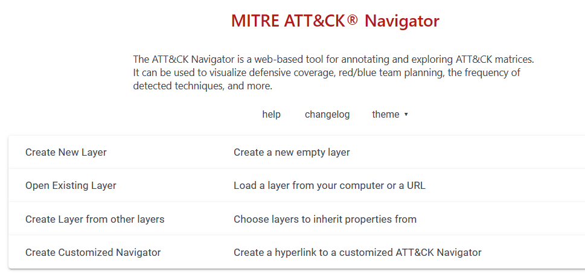
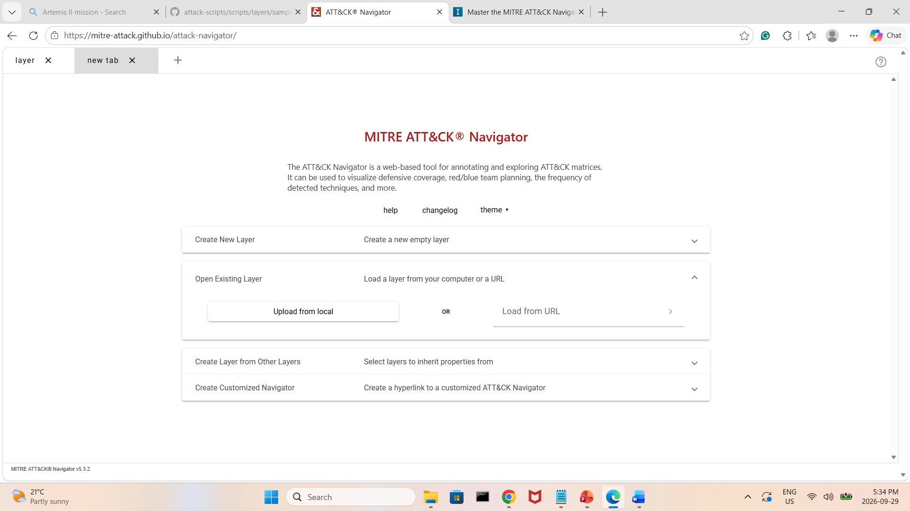
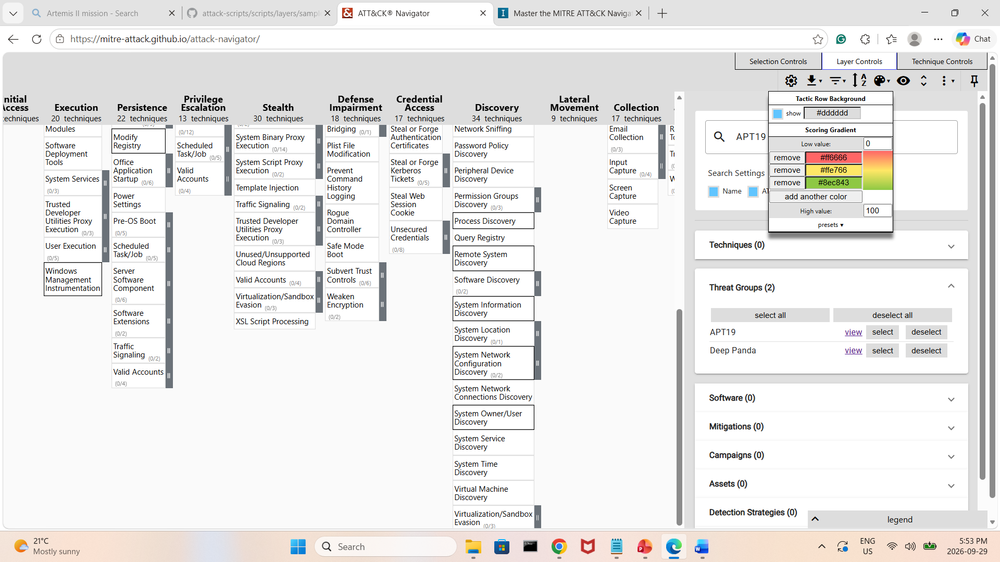
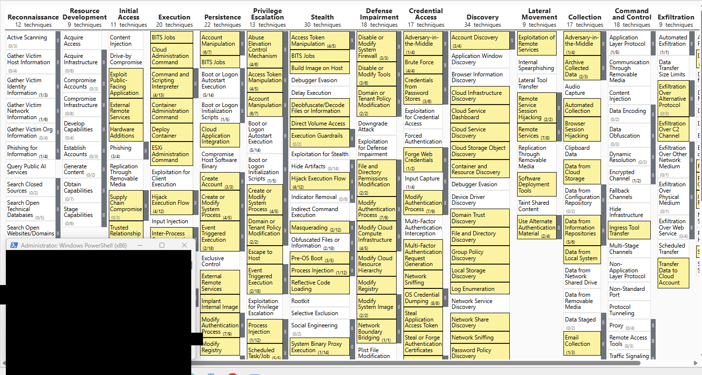
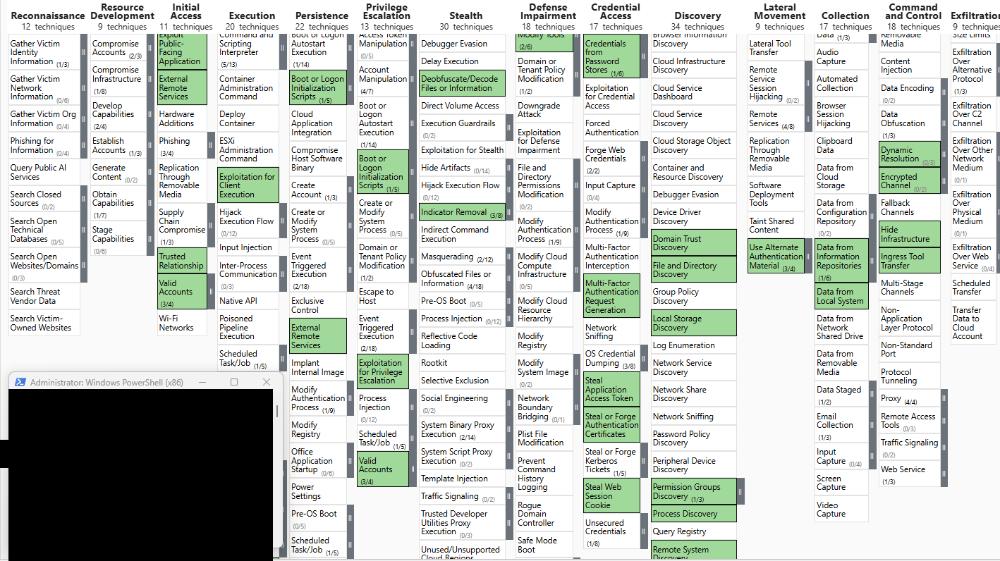
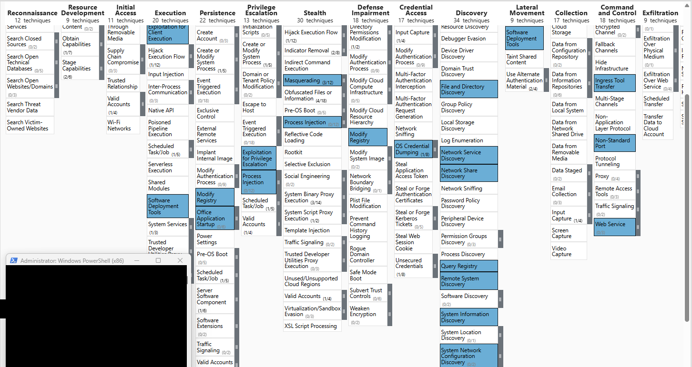
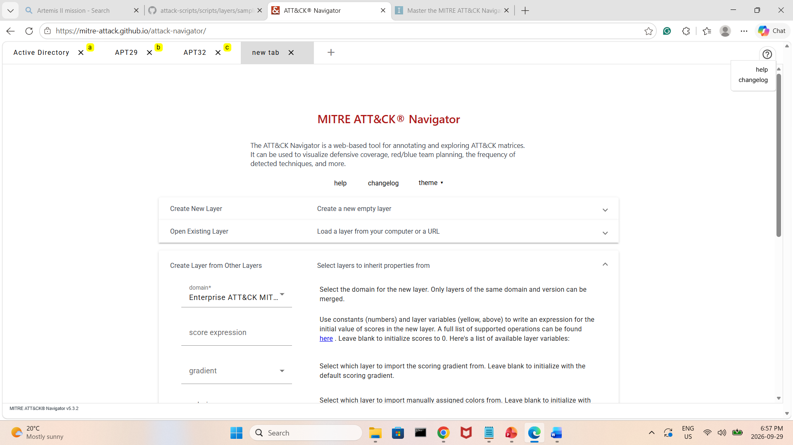
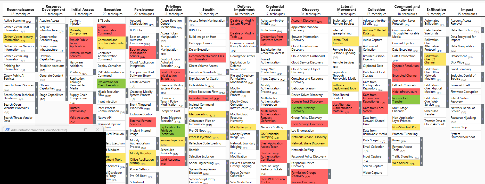
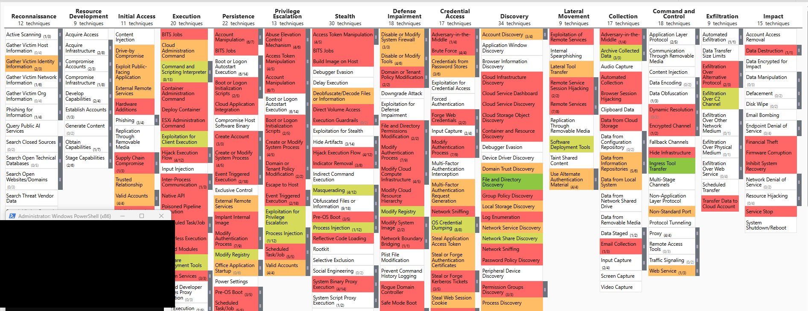

# Lab 3: MITRE ATT&CK Navigator

**Course:** CYT250 · Fall 2026
**Tool:** MITRE ATT&CK Navigator (web version, Enterprise domain)

## Objective

Learn the main operations of the ATT&CK Navigator: creating layers, searching techniques, setting metadata, scoring techniques with colors, and combining layers with score expressions to compare threat groups.

## Steps and Results

### 1. Open the Navigator and create a layer

The web version of the Navigator was opened and a new Enterprise layer was created. The three control groups were reviewed: selection controls, layer controls, and technical controls.

*Figure 1. The ATT&CK Navigator home page, used to create a new Enterprise layer.*

### 2. Search for techniques by group

A second layer was created and searched for the APT29 group. The layer shows the techniques used by that group across all tactics.

*Figure 2. A new layer with techniques associated with APT29, shown across all tactics.*

### 3. Layer controls

*Figure 3. The Layer Controls panel, used to manage the layers and their metadata.*

### 4. Layer metadata

The first layer was renamed **Active Directory** and given the value **1**.

*Figure 4. Metadata for the Active Directory layer.*

### 5. Set colors and scores

For each layer, a background color was set on the techniques and a score was assigned. The Active Directory layer was scored 2, and the APT29 layer was set up the same way. The APT32 layer was given a background color and a score of 4.

*Figure 5. The APT32 layer with its background color and score applied.*

Each layer was saved as a JSON object from the Layer Control panel.

### 6. Create a layer from other layers

The **Create Layer from Other Layers** dialog combines existing layers using a score expression.

*Figure 6. The Create Layer from Other Layers dialog.*

*Figure 7. The layers are labelled a, b, and c, and these labels are used in the score expression.*

### 7. Compare APT29 and APT32

The score expression was set to `b+c`, which combines the APT29 and APT32 layers. All layers were from the same domain and version. The resulting layer shows techniques from both groups.

*Figure 8. The score expression `b+c` used to combine the APT29 and APT32 layers.*

### 8. Combine all three layers

A new layer was created that combines all three layers.

*Figure 9. A new layer that combines the Active Directory, APT29, and APT32 layers.*

## Summary

The Navigator was used to build layers for a single topic (Active Directory) and for two threat groups (APT29 and APT32). The layers were then scored, colored, and combined with a score expression. This makes it easier to compare how the groups overlap and where they differ.
