# IoT Project 3: Sense HAT Device Shadows, AWS IoT Core, and Elastic Stack Monitoring

**Group 2** · Mark Waako · August 2026
**Tools:** Raspberry Pi (Sense HAT Emulator), AWS IoT Core, AWS IoT Python SDK, Amazon EC2, Elastic Stack (Elasticsearch and Kibana), Amazon VPC Flow Logs, Amazon S3

## Overview

This project connects a simulated Raspberry Pi sensor to AWS IoT Core. The device reports readings into an AWS IoT Device Shadow. The project then collects network traffic from the AWS environment in Kibana to look for suspicious activity.

| Part | Topic | Status |
|---|---|---|
| 1 | Set up the IoT device with AWS IoT Core | Complete |
| 2 | Python script: Device Shadow, Thing ID, and credentials | Complete |
| 3 | Security monitoring with Elastic Stack | Elastic Stack set up; Suricata rules and alerts not yet shown |
| 4 | Attack log analysis with S3-stored VPC Flow Logs | Complete |
| 5 | Presentation and report | Presentation pending schedule release |

## Part 1: Setting Up the IoT Device with AWS IoT Core

The sensing device is a Raspberry Pi running the **Sense HAT Emulator**. The emulator provides virtual temperature, pressure, humidity, and orientation controls in place of physical hardware. A test script streamed live readings to the terminal, which confirmed the data path worked before AWS integration began.

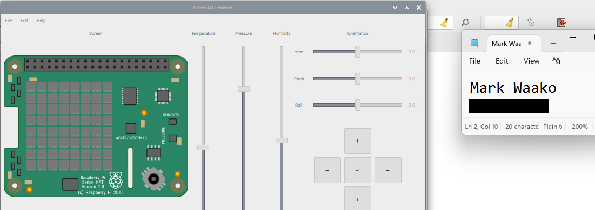
*Figure 1. The Raspberry Pi Sense HAT Emulator with its temperature, pressure, humidity, and orientation controls.*

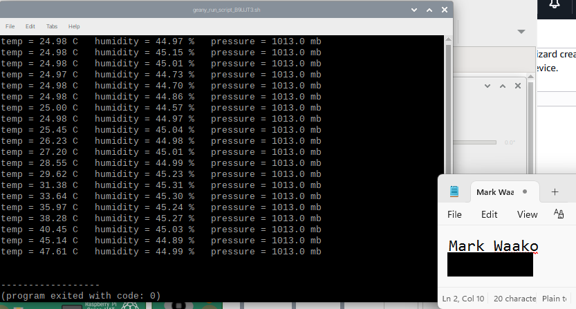
*Figure 2. Terminal output from the sensor script showing live temperature, humidity, and pressure values.*

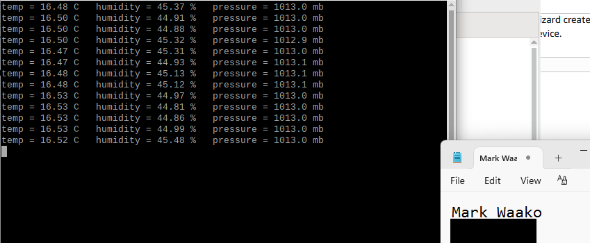
*Figure 3. Continued sensor readings at steady state.*

With the AWS IoT Thing connected, the **MQTT test client** was used to confirm inbound connectivity end to end before the shadow-update script was added.

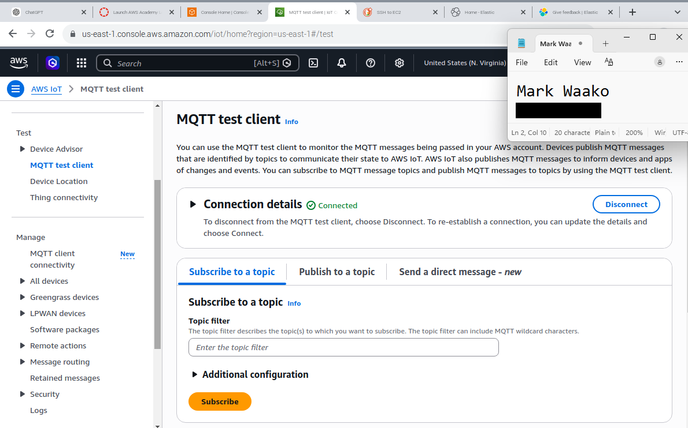
*Figure 4. The AWS IoT Core MQTT test client, Subscribe panel, with the connection established.*

## Part 2: Python Script: Device Shadow, Thing ID, and Keys

Rather than publishing raw MQTT messages, the script uses the **AWS IoT Python SDK's `AWSIoTMQTTShadowClient`** to report moisture and temperature into the device's **Shadow**. A Shadow is a persistent JSON document that AWS IoT Core keeps for each Thing. The script defines callbacks that fire when a shadow update is accepted, times out, or is rejected. On each accepted update, the callback logs the moisture and temperature values.

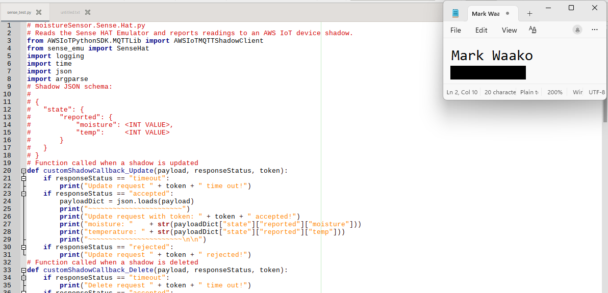
*Figure 5. The shadow-update script, with callbacks for accepted, timed-out, and rejected updates.*

The script runs with the device endpoint, Amazon Root CA, device certificate, private key, and Thing name passed as arguments. The Thing is `RaspberryPi` and the client ID is `RasperryPiTest001`.

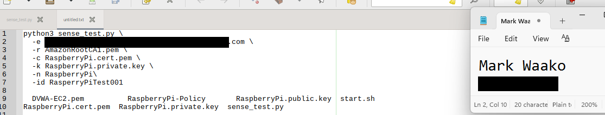
*Figure 6. Invoking the script with the endpoint, certificates, and Thing name.*

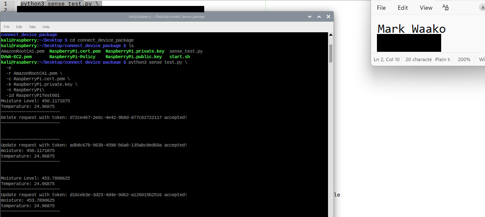
*Figure 7. Live run: shadow update requests are accepted, and each cycle reports moisture and temperature.*

The MQTT test client, subscribed to `$aws/things/RaspberryPi/shadow/update/accepted`, shows the shadow's reported state updating live.

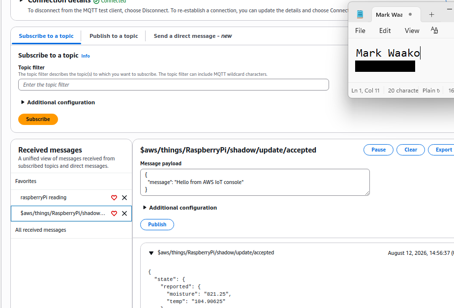
*Figure 8. Shadow update/accepted messages arriving live in the MQTT test client.*

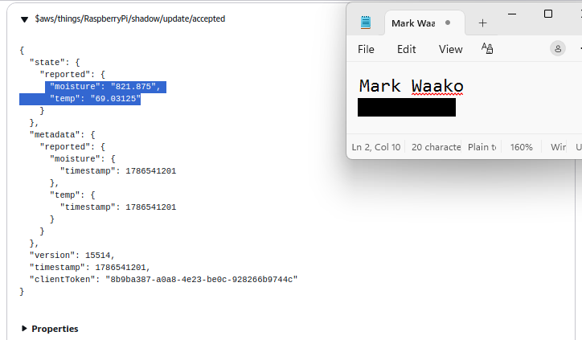
*Figure 9. The expanded shadow JSON: reported moisture and temperature, per-field metadata timestamps, version, and the `clientToken` that AWS IoT Core assigns to each update.*

The Thing's **Activity** tab in the AWS IoT console lists the stream of accepted shadow updates, which matches the output of the script.

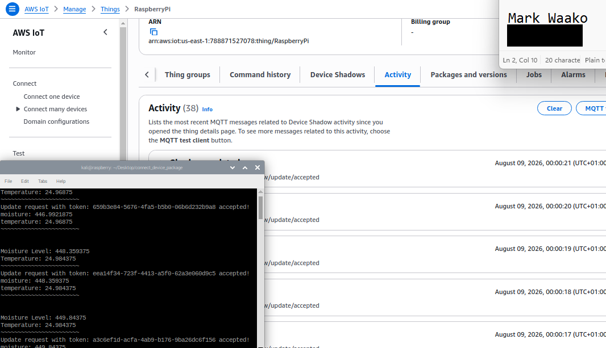
*Figure 10. The RaspberryPi Thing's Activity log in the AWS IoT console, listing shadow updates.*

## Part 3: Security Monitoring with the Elastic Stack

An EC2 instance hosts the Elastic Stack (Elasticsearch and Kibana). The configuration was edited on the instance using CloudShell and nano:

- **`kibana.yml`** sets the `elasticsearch.username` (`kibana_system`) and password that Kibana uses to authenticate to Elasticsearch.
- **`elasticsearch.yml`** sets the TLS keystore and truststore paths and the cluster's initial master node.
- **JVM heap options** are set to 512 MB (`-Xms512m` / `-Xmx512m`).

Kibana's home page is reachable and shows the Elasticsearch, Observability, Security, and Analytics modules.

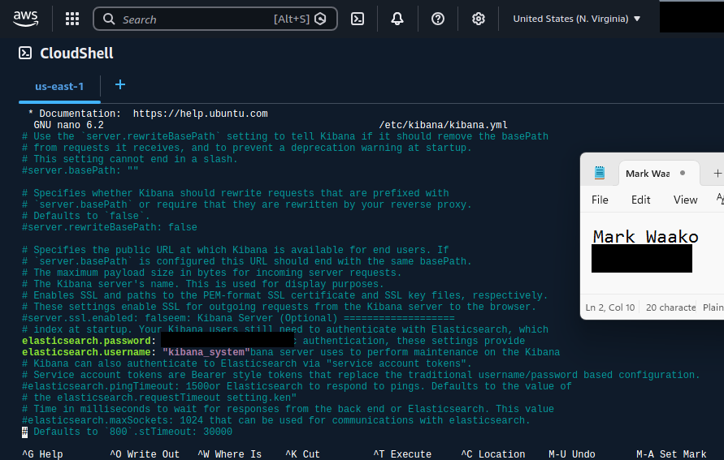
*Figure 11. `kibana.yml` configures `elasticsearch.username` and `elasticsearch.password` for Kibana-to-Elasticsearch authentication. The password value is redacted.*

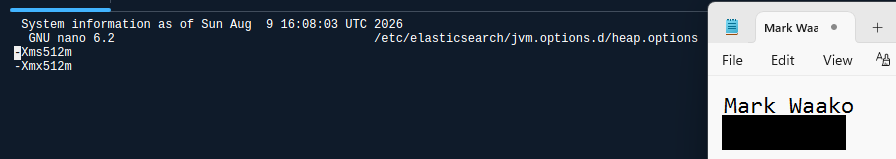
*Figure 12. The Elasticsearch JVM heap settings (`-Xms512m` and `-Xmx512m`).*

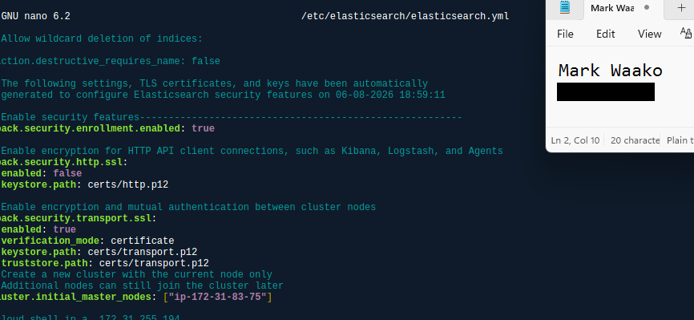
*Figure 13. `elasticsearch.yml`: TLS keystore and truststore paths, and the cluster's initial master node.*

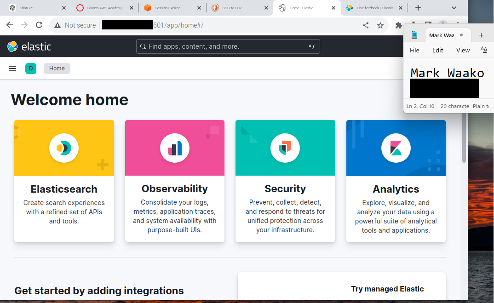
*Figure 14. The Kibana home page, reachable on the EC2 instance. The stack is running.*

**Still to do for Part 3:** Suricata has not yet been installed or configured. Suricata rules that detect the IoT threats, test output, `eve.json` alerts, and a Kibana dashboard built from those alerts are not in this report yet.

## Part 4: IoT Attack Log Analysis with S3-Stored VPC Flow Logs

VPC Flow Logs are delivered to an S3 bucket. They are organized by account, region, and date into daily folders. A CSV export of one day's data (**638 records, 14 fields**) was imported into Kibana's Machine Learning **Data Visualizer**. A more detailed investigation then covered a five-minute window on **August 12, 2026, from 14:49 to 14:54**, and narrowed the traffic step by step to isolate suspicious activity.

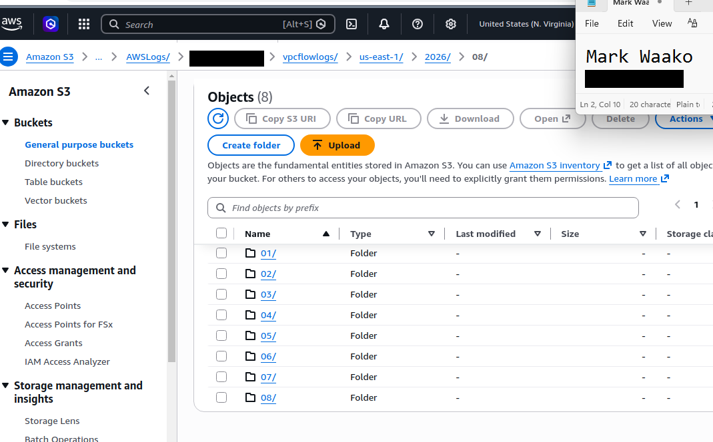
*Figure 15. The S3 path for VPC Flow Logs, organized by account, region, and date.*

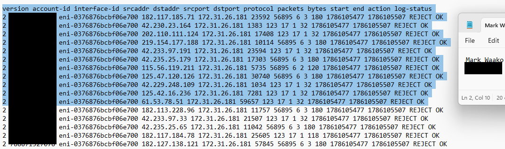
*Figure 16. Raw flow-log records with source and destination IPs, ports, protocol, packets, bytes, and the ACCEPT or REJECT action.*

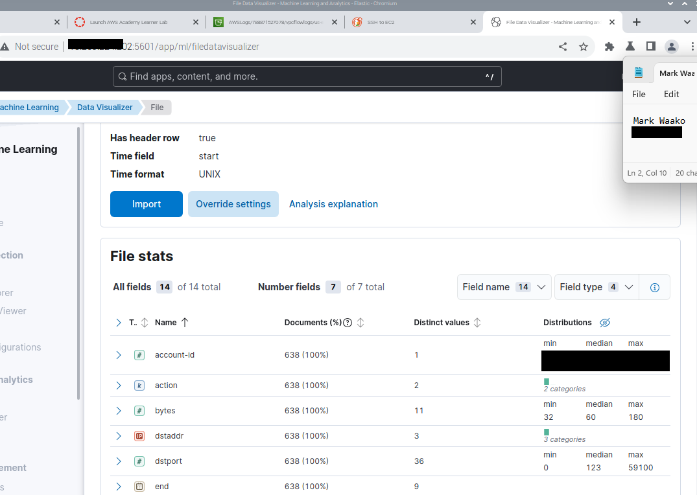
*Figure 17. The Data Visualizer import: 638 documents across 14 fields.*

### Progressive KQL drill-down (August 12, 14:49–14:54)

The query moved from the full window to the most suspicious traffic:

```kql
action : "REJECT"
dstport : "80" or dstport : "123" or dstport : "22" or dstport : "53"
protocol : 6
protocol : 17
packets > 50
```

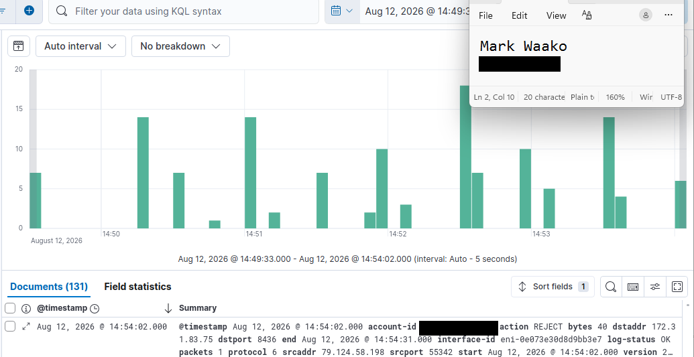
*Figure 18. The full five-minute window: 131 documents.*

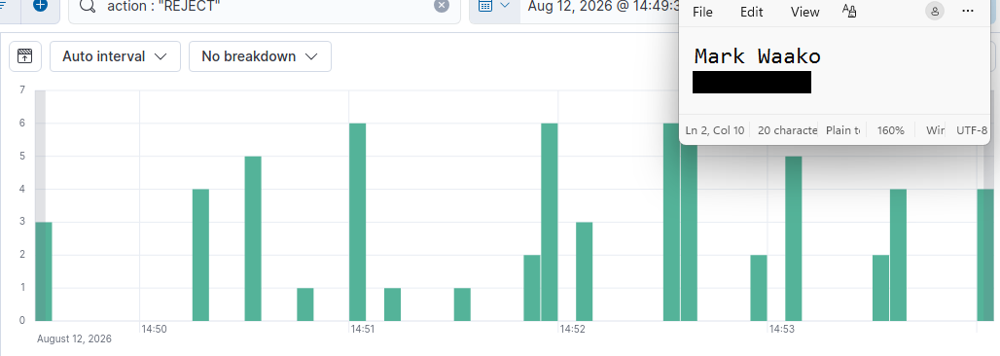
*Figure 19. Filtered to `action : "REJECT"`.*

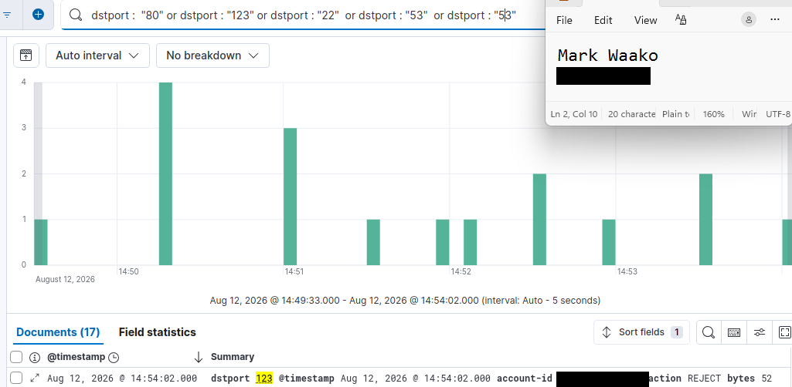
*Figure 20. Filtered to destination ports 80, 123, 22, and 53: 17 documents, showing scans against common services.*

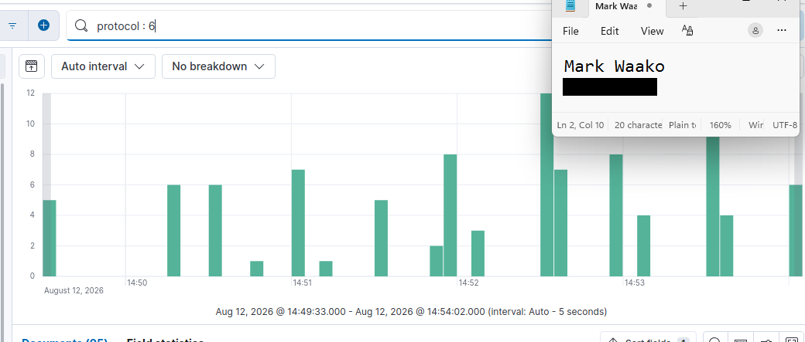
*Figure 21. Filtered to `protocol : 6` (TCP): 25 documents.*

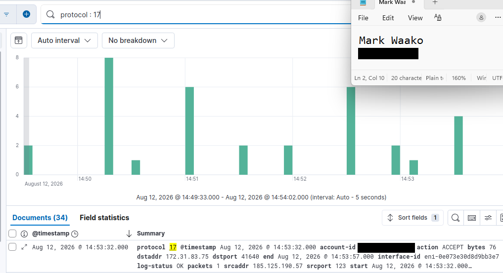
*Figure 22. Filtered to `protocol : 17` (UDP): 34 documents.*

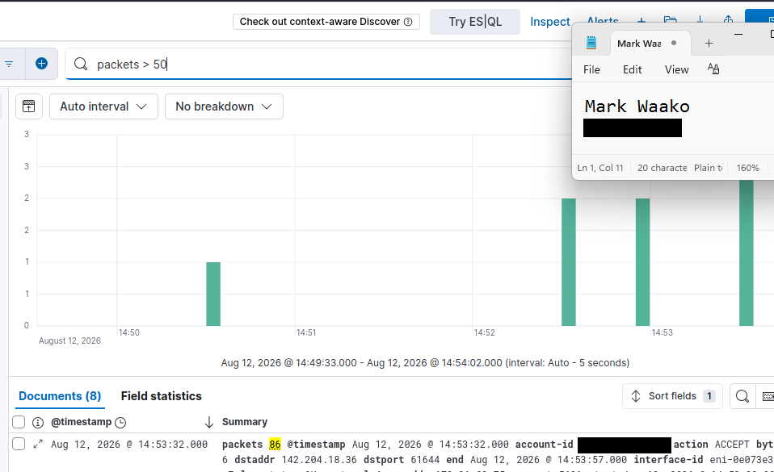
*Figure 23. Filtered to `packets > 50`: 8 documents, isolating high-volume bursts.*

## Part 5: Presentation and Report

This document is the written report. The presentation is pending. It will be scheduled once the presentation calendar is released, and a slide deck covering Parts 1 to 4 will be added then.
