# CYT230: Mobile Application Security Assessment (Project 1)

A group project that compares mobile application security testing tools and then uses MobSF to assess an intentionally vulnerable Android app, UnCrackable Level 1. The project also bypasses its root detection with a Frida script.

## Contents

1. [Introduction](#1-introduction)
2. [Mobile Security Tools Research](#2-mobile-security-tools-research)
3. [Recommended Tools](#3-recommended-tools)
4. [Additional Security Tool](#4-additional-security-tool)
5. [MobSF Lab Experiment](#5-mobsf-lab-experiment)
6. [Security Findings](#6-security-findings)
7. [Screenshots and Evidence](#7-screenshots-and-evidence)
8. [Challenges and Limitations](#8-challenges-and-limitations)
9. [Conclusion](#9-conclusion)
10. [References](#references)

## 1. Introduction

### 1.2 Objectives

This project explores mobile application security assessment tools and uses MobSF to identify potential security weaknesses in an Android application.

## 2. Mobile Security Tools Research

### 2.1 OWASP MASTG / MASVS

The Open Worldwide Application Security Project (OWASP) is a nonprofit that provides open-source resources, including information, services, standards, tools, and much more in relation to software security.

MASTG (Mobile Application Security Testing Guide) is an OWASP product that serves as an all-encompassing guide to testing app security. MASTG is a knowledge base, as well as a service that recommends tools, techniques, potential tests, test apps for training material, demos, and best practices.

MASVS (Mobile Application Security Verification Standard) is OWASP's recommended standard for the security of mobile applications. Considered an industry standard by many companies, MASVS also provides recommendations for controls used to verify the security of applications during development and testing, including how to measure the results.

These work together with MASWE (Mobile Application Security Weakness Enumeration), a service that catalogues known mobile application security weaknesses, to inform the process of developing and testing mobile applications against security standards.

### 2.2 MobSF

The Mobile Security Framework (MobSF) is an automated, all-in-one mobile application security testing framework designed for Android, iOS, and Windows applications. It supports penetration testing, malware analysis, and security assessments through both static and dynamic analysis. MobSF performs static analysis (SAST) by analyzing mobile application binaries, such as APK, AAB, IPA, and APPX files, as well as source code. It decompiles and analyzes applications and reports on any potential flaws it finds. MobSF also supports dynamic analysis (DAST), which allows applications to be analyzed while they are running.

MobSF is built around a Django-based web application, with its web interface running on port 8000 by default. Its analysis engine receives the application, determines what needs to be analyzed, invokes the appropriate analysis tools, interprets their output, applies security rules, and builds the final report.

### 2.3 Frida

Frida is a dynamic instrumentation toolkit used by developers, reverse engineers, security researchers, mobile security testers, and malware analysts. Frida allows users to inspect and modify a running application without its source code or recompiling it. A tester can observe a method's arguments and return values and alter its behavior at runtime. It is commonly used to analyze application behavior and vulnerabilities, debug Android and iOS applications, and observe suspicious program activity for profiling and diagnostics.

### 2.4 Objection

Objection is a runtime mobile exploration toolkit built on top of Frida. It supports security testing without requiring a rooted or jailbroken device. It is not itself a jailbreak or root bypass, but it provides a close look into an application at a lower level. It supports both Android and iOS, and can be used to inspect container file systems, bypass SSL pinning, dump keychains, perform memory-related tasks such as dumping or patching, and explore and manipulate objects on the heap. On iOS, it can bypass JailMonkey and other jailbreak-detection mechanisms, and it can dump encoded files in a human-readable format. Objection is free, open source, and available on GitHub.

### 2.5 Drozer 3

Drozer is a framework for Android device security testing, similar to Metasploit. Drozer 3.1.0 is the latest release. It searches for security vulnerabilities by acting on an application from the outside: assuming an app's role, sending altered data over inter-process communication (IPC), or acting from the operating system and runtime of the device. Users connect a Drozer agent APK on the device to a Drozer console on a PC and run commands from the console.

Drozer is commonly used to identify exported activities. These are activities that can be launched by a process originating outside the application. Non-exported activities must be started by another process within the application with the same user ID, which prevents other services or applications from starting critical activities such as password resets. Identifying and fixing these misconfigurations is an important step in preventing their use as an exploitation method.

### 2.6 jadx

JADX is an open-source, Android-specific decompiler. It takes compiled Android application code (DEX bytecode inside an APK) and converts it into human-readable, Java-like source code. It reverses the process by which Java or Kotlin source is compiled into Dalvik bytecode and packaged into DEX files.

JADX includes a command-line version and a graphical interface (jadx-gui), which lets analysts browse decompiled code, search the application, jump between declarations and usages, and perform other reverse-engineering tasks. It is useful in mobile security because analysts can inspect an application's internal logic without access to the original project. JADX is also integrated into MobSF as one component of its analysis process.

### 2.7 iGoat-Swift

iGoat-Swift is an intentionally vulnerable iOS application for learning and practicing mobile application security testing. It provides a safe, hands-on environment for exploring common weaknesses in Swift-based iOS applications, including insecure data storage, authentication and authorization issues, insecure communication, cryptographic weaknesses, and input validation problems. Each vulnerability shows how a flaw can arise and how it can be identified and analyzed.

### 2.8 DVIA-v2

DVIA (Damn Vulnerable iOS App) is an application built for practicing penetration testing, with vulnerabilities targeting iOS 11 deliberately built in. It includes weaknesses in local data storage, jailbreak detection, excessive permissions, runtime manipulation, Face ID bypass, side-channel data leakage, IPC, broken cryptography, WebView handling, network layer security, application patching, and sensitive data held in memory. The purpose of DVIA is to let developers see the impact of these issues firsthand so they can avoid introducing them into their own applications.

## 3. Recommended Tools

For Android, we recommend MobSF for automated analysis and jadx for examining application code. For iOS, we recommend MobSF for initial assessment and Frida for runtime testing on a compatible test device.

## 4. Additional Security Tool

### APKLeaks

APKLeaks searches Android APK files for potentially exposed URLs, endpoints, and secrets that may be useful during security assessments.

## 5. MobSF Lab Experiment

The objective of this lab is to use MobSF to analyze an intentionally vulnerable Android application and identify potential security issues.

MobSF was installed on Kali Linux by cloning the GitHub repository, going into the project directory, and running the setup script:

```bash
git clone https://github.com/MobSF/Mobile-Security-Framework-MobSF.git
cd Mobile-Security-Framework-MobSF
./setup.sh
```

### 5.1 Lab Environment

MobSF was started with `./run.sh 127.0.0.1:8000`, giving sign-in access through the local web interface at 127.0.0.1:8000.

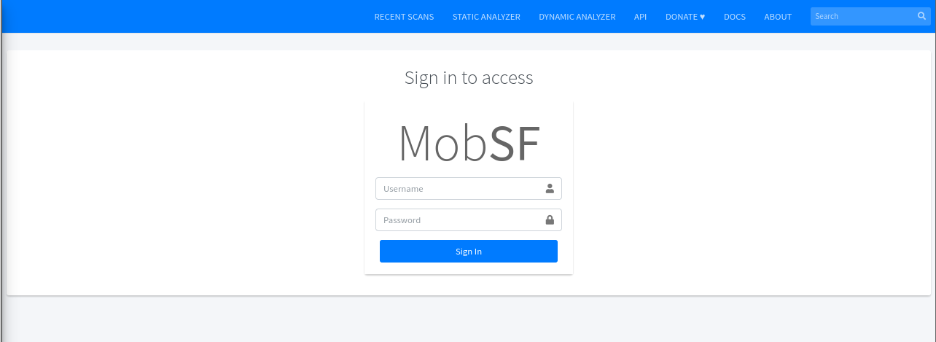
*Figure 1. MobSF lab environment: a local instance running at 127.0.0.1:8000.*

### 5.2 Installation and Configuration

The MobSF Docker image was downloaded and launched locally, making the analysis interface available in a web browser at `http://localhost:8000`.

```bash
sudo docker run -it --rm \
  -p 8000:8000 \
  -p 1337:1337 \
  -e MOBSF_ANALYZER_IDENTIFIER=192.168.98.128:5555 \
  --add-host=host.docker.internal:host-gateway \
  opensecurity/mobile-security-framework-mobsf:latest
```

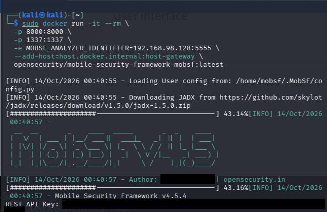
*Figure 2. The MobSF Docker container starting up, with its startup log.*

### 5.3 Target Application

UnCrackable Level 1, an intentionally vulnerable Android application from the OWASP MASTG crackme series, was selected as the target.

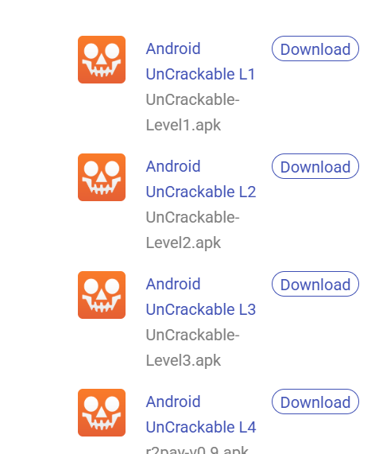
*Figure 3. The target application selected for analysis.*

### 5.4 Static Analysis

The target APK was uploaded to MobSF and a static security scan was run, covering permissions, certificates, network security configuration, and potential vulnerabilities. The scan returned a security score of 55/100 (grade B) for UnCrackable Level 1.

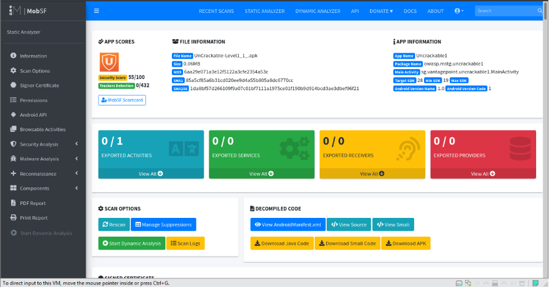
*Figure 4. The MobSF static analysis dashboard for UnCrackable Level 1.*

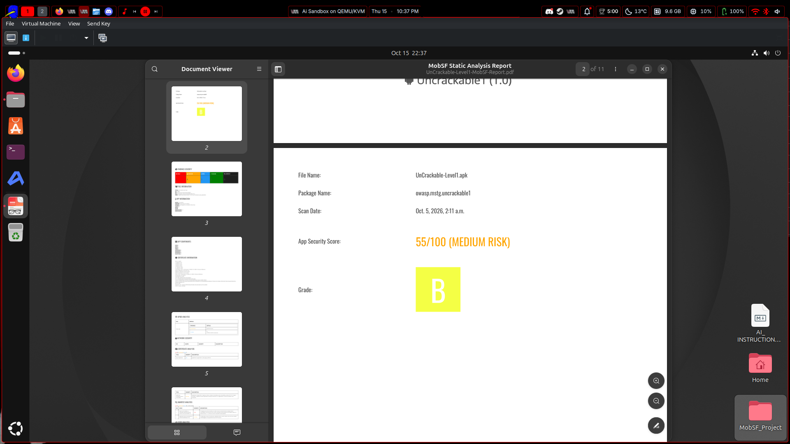
*Figure 5. The MobSF static analysis PDF report for UnCrackable Level 1: scan date, package name, 55/100 security score, and grade.*

### 5.5 Dynamic Analysis

Dynamic analysis was run with MobSF's dynamic analyzer against an Android emulator. The app was run and its behavior observed in real time, including its built-in root-detection check.

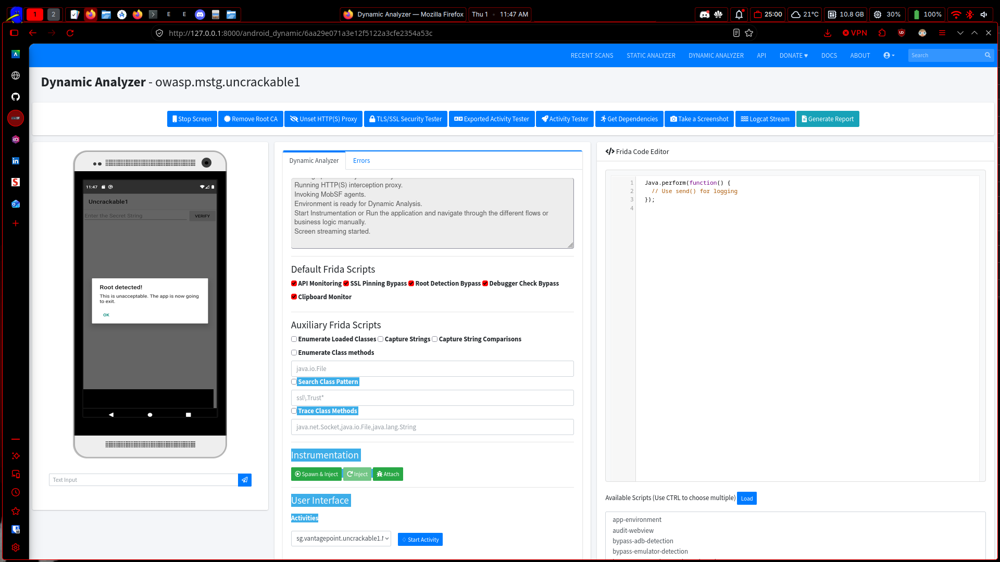
*Figure 6. Dynamic analysis of UnCrackable Level 1. The app's root-detection prompt is visible on the emulated screen.*

### 5.6 MASVS Report

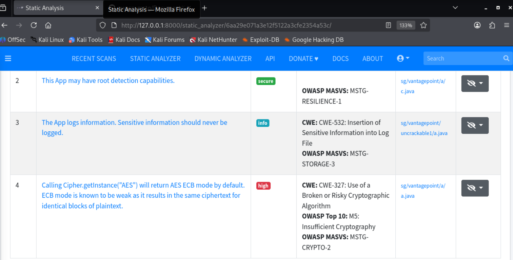
*Figure 7. Static analysis findings from MobSF, mapped to OWASP MASVS and CWE identifiers.*

## 6. Security Findings

The static scan flagged several issues, including:

- **Root detection** (MSTG-RESILIENCE-1): the app contains root-detection logic that can be analyzed and bypassed.
- **Sensitive data in logs** (CWE-532, MSTG-STORAGE-3): the app writes information to the log that should never be logged.
- **Weak cipher mode** (CWE-327, MSTG-CRYPTO-2): calling `Cipher.getInstance("AES")` returns AES in ECB mode by default, which is weak because identical plaintext blocks produce identical ciphertext.

## 7. Screenshots and Evidence

The following screenshots document the lab walkthrough in order: environment setup, ADB and network configuration, Frida script development, and the final successful bypass.

### 7.1 Emulator Setup

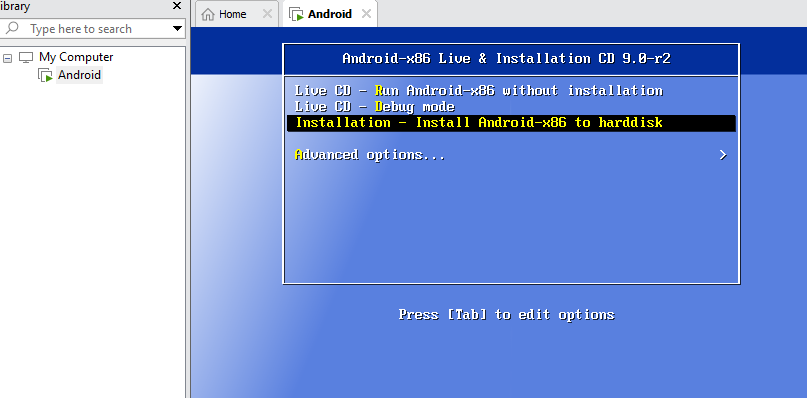
*Figure 8. Choosing the install option for the Android virtual device.*

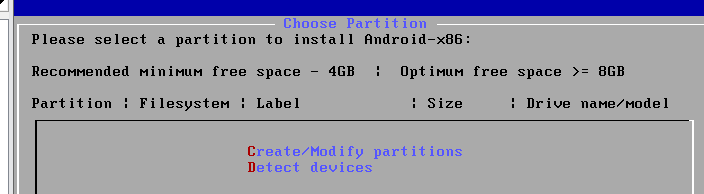
*Figure 9. Creating the device partition.*

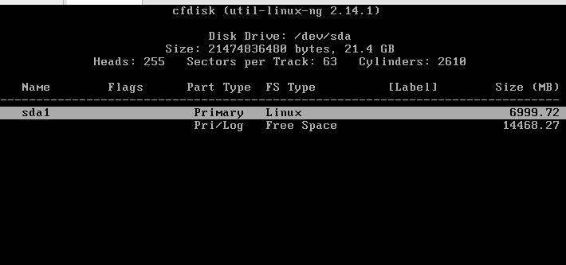
*Figure 10. Allocating 4 GB or more of storage to the virtual device.*

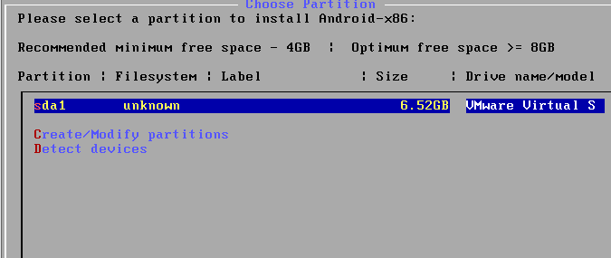
*Figure 11. Confirming the configuration.*

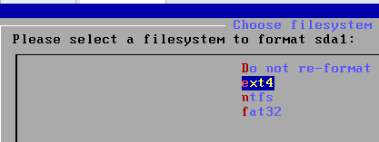
*Figure 12. Selecting ext4 as the filesystem for the device image.*

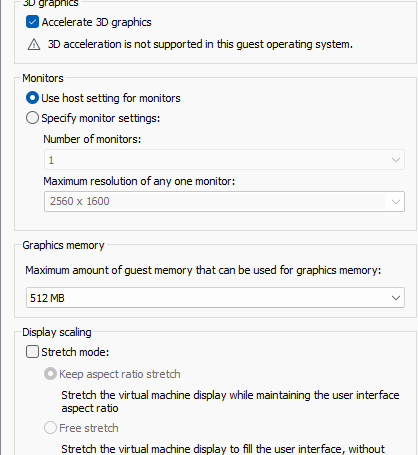
*Figure 13. Final Android emulator settings.*

### 7.2 ADB and Network Configuration

Commands used to install ADB and access the Android VM's ADB shell:

```bash
sudo apt install adb
sudo apt install google-android-platform-tools-installer
```

Commands used to configure the network connection for Android, run as `su`:

```bash
setprop service.adb.tcp.port 5555
stop adbd
start adbd
```

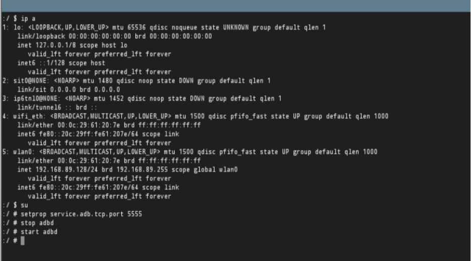
*Figure 14. Android network configuration.*

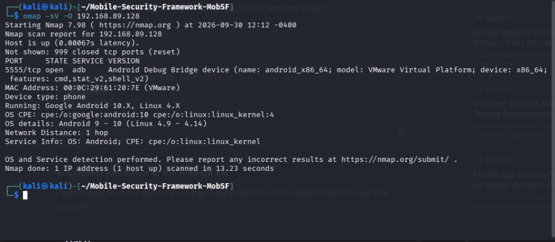
*Figure 15. Verifying connectivity to the Android VM from Kali using nmap.*

### 7.3 Target Application Setup

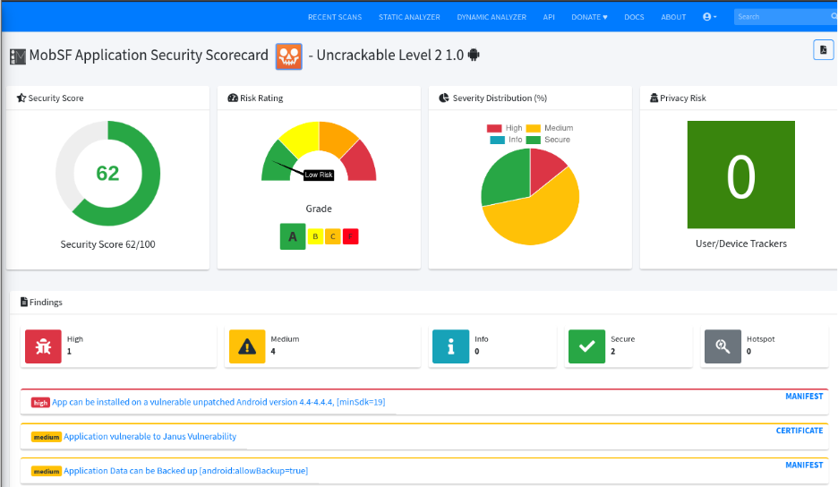
*Figure 16. Installing UnCrackable Level 2 as an additional target application.*

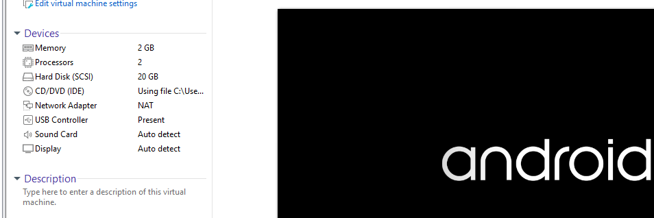
*Figure 17. Android virtual machine settings and boot screen.*

### 7.4 Frida Script Development

An initial Frida script was written to bypass UnCrackable Level 1's root-detection checks by overriding the methods that detect su binaries, test-keys, and root-related packages:

```javascript
Java.perform(function () {
  // Target the specific custom package inside Uncrackable Level 1
  var RootCheckClass = Java.use("sg.vantagepoint.a.c");

  // Bypass binary/su path check
  RootCheckClass.a.implementation = function() {
    console.log("[Custom Frida] Bypassed su binary check (a)");
    return false;
  };

  // Bypass test-keys check
  RootCheckClass.b.implementation = function() {
    console.log("[Custom Frida] Bypassed test-keys check (b)");
    return false;
  };

  // Bypass root app packages check
  RootCheckClass.c.implementation = function() {
    console.log("[Custom Frida] Bypassed root packages check (c)");
    return false;
  };

  console.log("[Custom Frida] Uncrackable Level 1 root hooks active!");
});
```

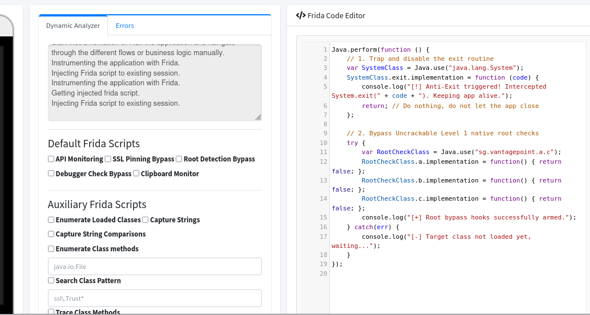
*Figure 18. The root-detection bypass script loaded in the Frida code editor.*

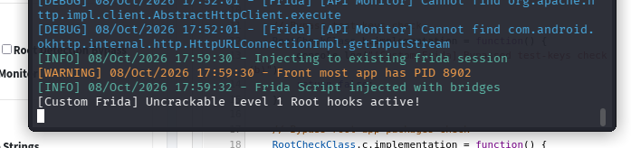
*Figure 19. Script output confirming the root hooks were armed.*

The application called `System.exit()` as soon as root was detected, closing the app before the bypass script could attach. The script was extended to trap and disable the exit routine, which keeps the app alive long enough to apply the root-detection bypass:

```javascript
Java.perform(function () {
  // 1. Trap and disable the exit routine
  var SystemClass = Java.use("java.lang.System");
  SystemClass.exit.implementation = function (code) {
    console.log("[!] Anti-Exit triggered! Intercepted System.exit(" + code + "). Keeping app alive.");
    return; // Do nothing, do not let the app close
  };

  // 2. Bypass Uncrackable Level 1 native root checks
  try {
    var RootCheckClass = Java.use("sg.vantagepoint.a.c");
    RootCheckClass.a.implementation = function() { return false; };
    RootCheckClass.b.implementation = function() { return false; };
    RootCheckClass.c.implementation = function() { return false; };
    console.log("[+] Root bypass hooks successfully armed.");
  } catch(err) {
    console.log("[-] Target class not loaded yet, waiting...");
  }
});
```

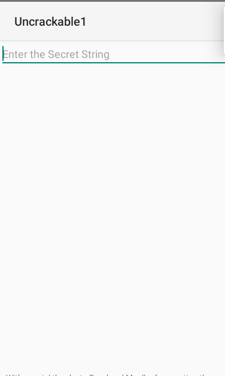
*Figure 20. The updated script with the anti-exit hook, which keeps the application running after root detection.*

Finally, a third hook intercepts the application's decryption routine. It lets the call proceed normally while capturing and logging the decrypted secret string:

```javascript
Java.perform(function () {
  // 1. Trap and disable the exit routine
  var SystemClass = Java.use("java.lang.System");
  SystemClass.exit.implementation = function (code) {
    console.log("[!] Anti-Exit triggered! Intercepted System.exit(" + code + "). Keeping app alive.");
    return;
  };

  // 2. Bypass Uncrackable Level 1 native root checks
  try {
    var RootCheckClass = Java.use("sg.vantagepoint.a.c");
    RootCheckClass.a.implementation = function() { return false; };
    RootCheckClass.b.implementation = function() { return false; };
    RootCheckClass.c.implementation = function() { return false; };
    console.log("[+] Root bypass hooks successfully armed.");
  } catch(err) {
    console.log("[-] Target class not loaded yet, waiting...");
  }

  // 3. Hook the decryption method to reveal the secret key
  try {
    var CryptoClass = Java.use("sg.vantagepoint.a.a");
    CryptoClass.a.implementation = function (arg1, arg2) {
      var decryptedBytes = this.a(arg1, arg2);
      var secretString = "";
      for (var i = 0; i < decryptedBytes.length; i++) {
        secretString += String.fromCharCode(decryptedBytes[i]);
      }
      console.log("[*] SUCCESS! Found Secret Key: " + secretString);
      return decryptedBytes;
    };
    console.log("[+] Secret extraction hook is armed and ready.");
  } catch(err) {
    console.log("[-] Failed to hook crypto class: " + err);
  }
});
```

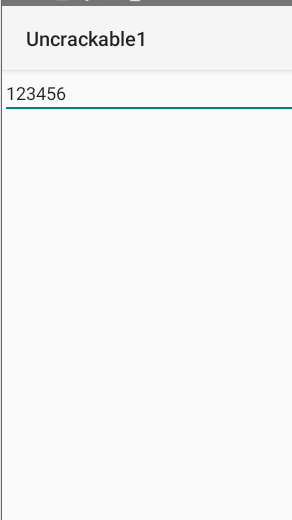
*Figure 21. The final combined script (root bypass, anti-exit, and secret extraction) loaded in Frida.*

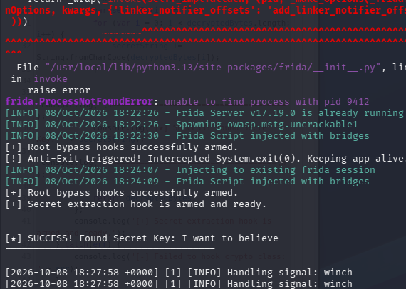
*Figure 22. Console output showing the extracted secret key.*

### 7.5 Result

The extracted secret was entered into the application's input field and accepted as correct, confirming that the bypass worked.

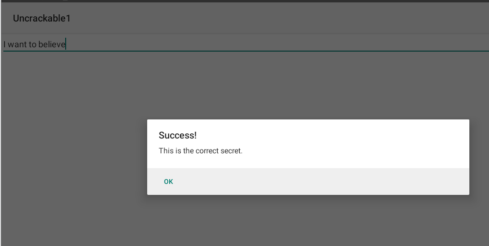
*Figure 23. UnCrackable Level 1 accepting the extracted secret string as correct.*

## 8. Challenges and Limitations

The biggest challenge was timing. The application's root-detection check ran so quickly after launch that the instrumentation scripts could not attach in time, and the app called `System.exit()` and terminated before the bypass could take effect.

Each time the app terminated itself, it also broke the connection to the MobSF web dashboard and cleared the loaded Frida script, so the script had to be reloaded manually. This led to the additional "anti-exit" hook, which intercepts and disables `System.exit()` and keeps the app running long enough to apply the root-detection bypass and extract the secret key.

## 9. Conclusion

Relying entirely on client-side security checks and environment validation provides insufficient defense against targeted runtime manipulation. Using runtime instrumentation, a tester can intercept an application's core logic and disable security controls such as root detection and process-termination mechanisms from the moment the application starts.

## References

- OWASP Foundation. *Mobile Application Security Verification Standard (MASVS)* and *UnCrackable Level 1 Crackme*. https://owasp.org
- Mobile Security Framework (MobSF). *Automated Mobile App Security Testing and Dynamic Analyzer Instrumentation*. https://github.com
- Frida. *Dynamic Instrumentation Toolkit for Developers, Reverse-Engineers, and Security Researchers*. https://frida.re
