# SIEM Home Lab: AlienVault OSSIM with OSSEC Agents

**Date:** October 20, 2026
**Tools:** VMware Workstation, pfSense, AlienVault OSSIM 5.7.4, OSSEC HIDS 3.6.0, Kali Linux, Metasploitable2, Windows 10, nmap, AlienVault OTX

## Overview

This lab builds a small, segmented network with a SIEM (Security Information and Event Management) platform at its centre. The goals were to:

1. Isolate the lab behind a pfSense firewall on its own LAN segment.
2. Deploy AlienVault OSSIM as the SIEM and confirm it can reach the lab.
3. Discover and inventory the hosts on the network with nmap.
4. Enrol endpoints with OSSEC HIDS agents so their logs flow into the SIEM.
5. Connect the SIEM to AlienVault Open Threat Exchange (OTX) for threat-intelligence feeds, and troubleshoot the network and configuration issues that blocked the feed download.

**Skills demonstrated:** virtual network design, firewall and network segmentation, SIEM deployment and configuration, host-based intrusion detection (HIDS) agent deployment, network reconnaissance, Linux administration and troubleshooting, and threat-intelligence integration.

> Screenshots that showed an API key have been redacted.

## Lab Architecture

| Machine | Role | Resources | Address |
|---|---|---|---|
| pfSense | Firewall / gateway | NAT adapter (WAN), LAN Segment adapter (LAN) | WAN 192.168.89.128 (DHCP), LAN 192.168.1.1/24 |
| AlienVault OSSIM 5.7.4 | SIEM server | 4 GB RAM, 2 vCPU, 30 GB disk | eth0 192.168.89.5 (management), eth1 192.168.1.105 (log collection) |
| Kali Linux | Attacker / scanner | 2 GB RAM, 4 vCPU, 80 GB disk | 192.168.1.100 |
| Windows 10 | Endpoint (OSSEC agent) | 3.5 GB RAM, 2 vCPU, 60 GB disk | 192.168.1.103 |
| Metasploitable2 | Intentionally vulnerable target | 512 MB RAM | 192.168.1.101 |

All lab machines sit on a custom VMware LAN segment named **Pfsense**, so they are isolated from the host network except through the firewall.

## Phase 1: Network Segmentation with pfSense

Each lab VM was attached to the custom **Pfsense** LAN segment rather than NAT or bridged networking. The pfSense VM has two adapters: NAT for the WAN side (to reach the internet) and the LAN segment for the internal network. pfSense then routes traffic for the lab machines.

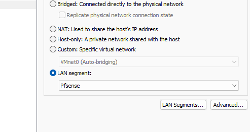
*Figure 1. The VMware network adapter is set to the custom LAN segment "Pfsense" instead of NAT or bridged, which keeps lab machines on an isolated internal network behind the firewall.*

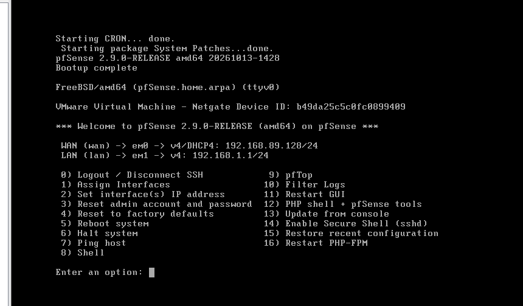
*Figure 2. The pfSense console shows the WAN interface on 192.168.89.128 (DHCP) and the LAN interface on 192.168.1.1/24. The LAN address is the default gateway for every lab machine.*

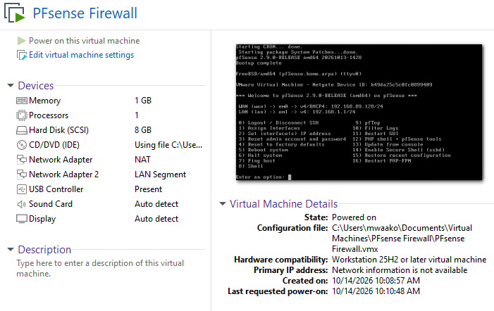
*Figure 3. The pfSense VM uses two adapters: NAT for WAN and the LAN Segment for the internal network.*

## Phase 2: Building the Virtual Machines

**AlienVault OSSIM** was given 4 GB of memory, 2 processors and a 30 GB disk, with its adapter on the LAN segment. Its console confirmed the address 192.168.1.105.

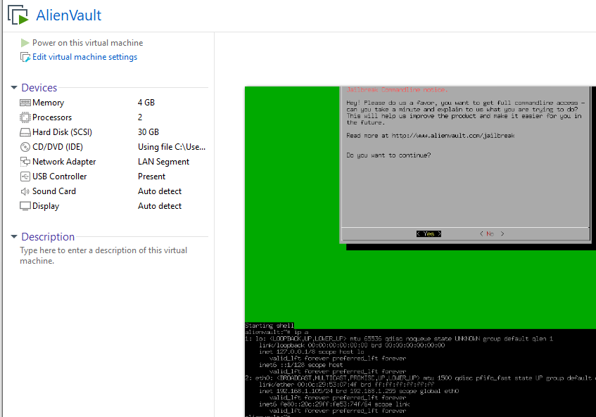
*Figure 4. The AlienVault VM: 4 GB memory, 2 processors, 30 GB disk, on the LAN Segment, with address 192.168.1.105.*

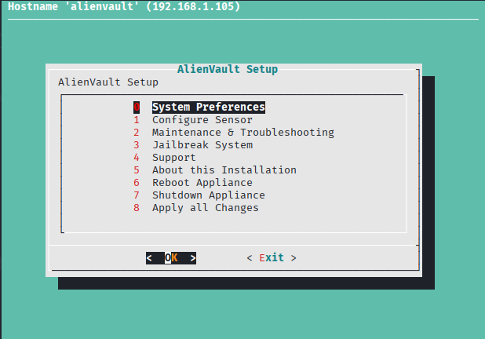
*Figure 5. The AlienVault setup menu offers System Preferences, Configure Sensor and Apply all Changes. The header confirms the hostname `alienvault` at 192.168.1.105.*

**Kali Linux** was given 2 GB of memory, 4 processors and an 80 GB disk on the LAN segment. It received 192.168.1.100 from pfSense, confirming it is on the same segment as the SIEM.

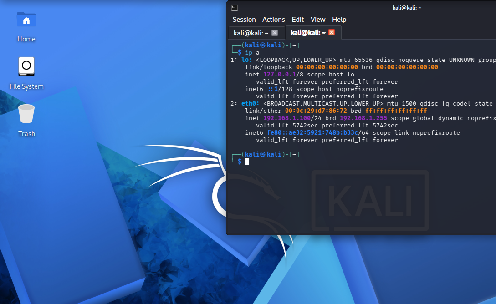
*Figure 6. `ip a` on Kali shows `eth0` with 192.168.1.100/24, so it received a LAN address through pfSense.*

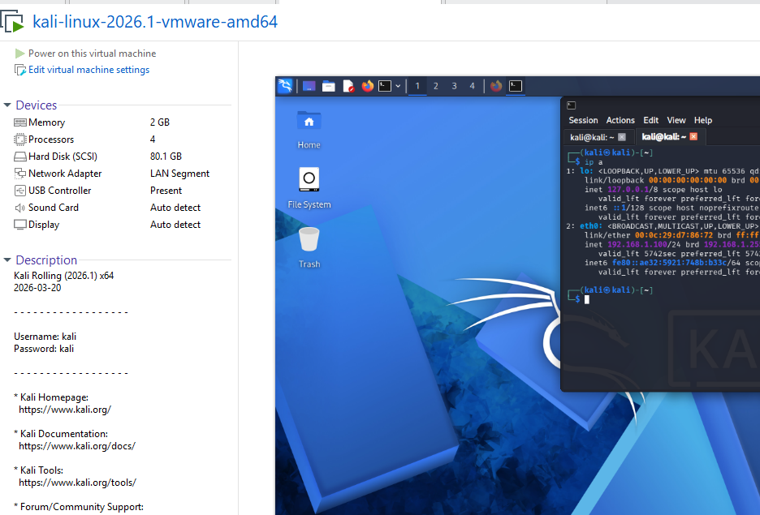
*Figure 7. The Kali Linux VM: 2 GB memory, 4 processors, 80 GB disk, on the LAN Segment. The terminal shows the same 192.168.1.100 address.*

**Metasploitable2** is the intentionally vulnerable Linux target. It was powered on so the SIEM could monitor it.

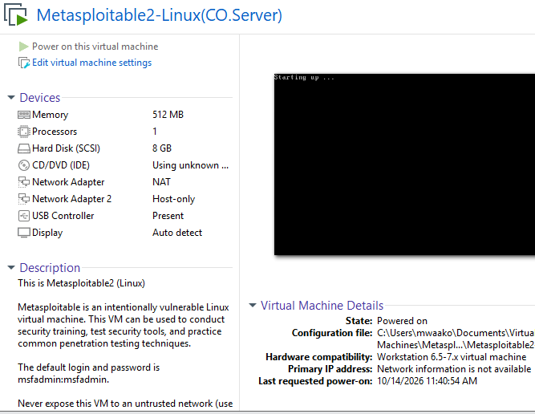
*Figure 8. The Metasploitable2 VM: 512 MB memory, powered on and booting so the SIEM can monitor it.*

**Windows 10** was chosen for the endpoint so that all VMs could run together in the lab. The VM has 3.5 GB of memory, 2 processors and a 60 GB disk, and it was set up with Chrome, Notepad++, OWASP ZAP and Docker Desktop.


*Figure 9. The Windows 10 desktop with Chrome, Notepad++, OWASP ZAP and Docker Desktop installed. This machine acts as the Windows endpoint in the SIEM lab.*

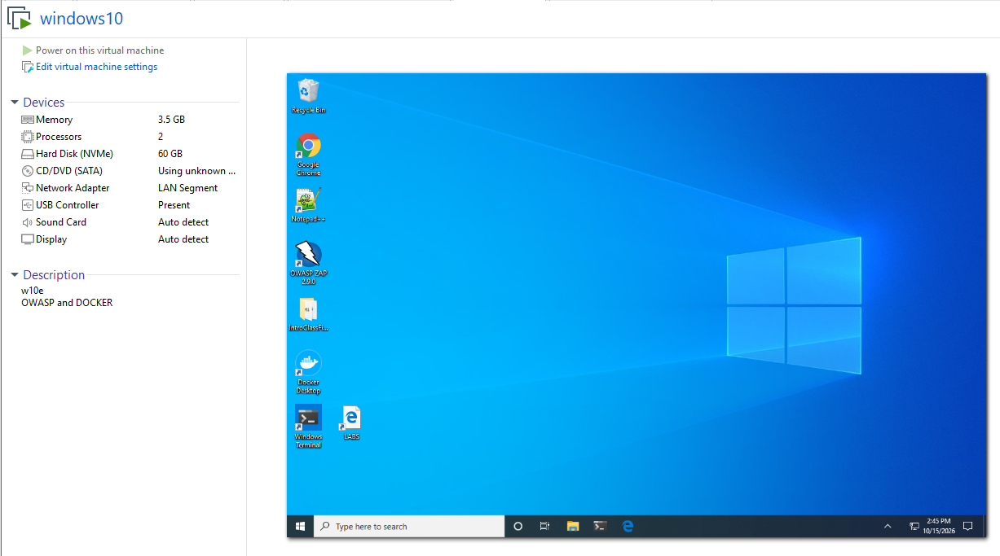
*Figure 10. The windows10 VM: 3.5 GB memory, 2 processors, 60 GB disk, on the LAN Segment.*


*Figure 11. The VMware tabs show all five lab machines (pfSense, AlienVault, Kali, windows10 and Metasploitable2) running at the same time.*

## Phase 3: Network Discovery with nmap

From Kali, I ran a ping sweep of the LAN and then fingerprinted each discovered host. The results matched the expected hosts and were used to build the asset inventory in the SIEM.

```bash
nmap -sn 192.168.1.0/24
```

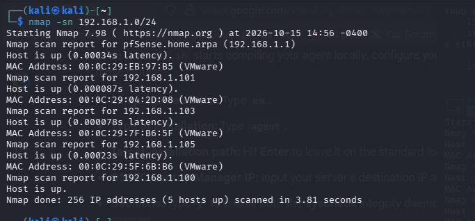
*Figure 12. A ping sweep with `nmap -sn 192.168.1.0/24` from Kali finds five live hosts, including the pfSense gateway at 192.168.1.1.*

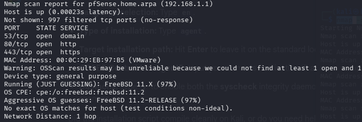
*Figure 13. Scanning 192.168.1.1 shows ports 53, 80 and 443 open and fingerprints the device as FreeBSD, consistent with pfSense. Only its DNS and web interface are exposed.*

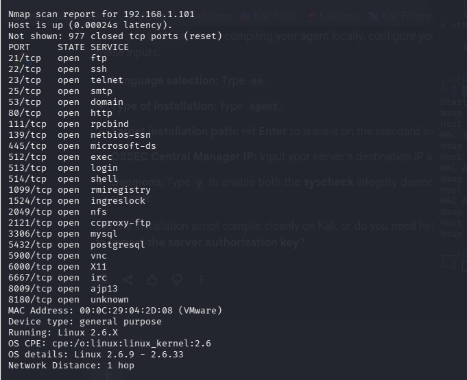
*Figure 14. Scanning 192.168.1.101 shows many open services (FTP, SSH, Telnet, SMB, MySQL) on a Linux 2.6.x kernel, consistent with Metasploitable2.*

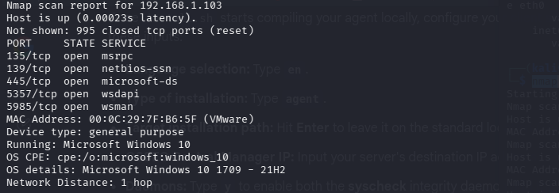
*Figure 15. Scanning 192.168.1.103 shows ports 135, 139, 445, 5357 and 5985 open and identifies the host as Microsoft Windows 10. This is the endpoint that runs the OSSEC agent.*

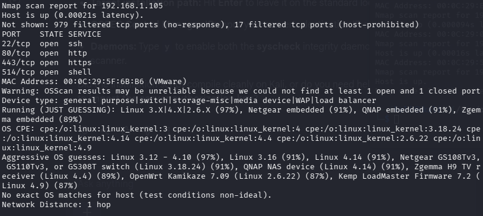
*Figure 16. Scanning 192.168.1.105 shows SSH, HTTP, HTTPS and port 514 open on a Linux host. This is the SIEM server that receives agent logs.*

## Phase 4: Configuring the SIEM

The AlienVault web setup asks for administrator details. The first attempt used a password that was flagged as very weak. A medium-strength password was then set, and setup was completed.

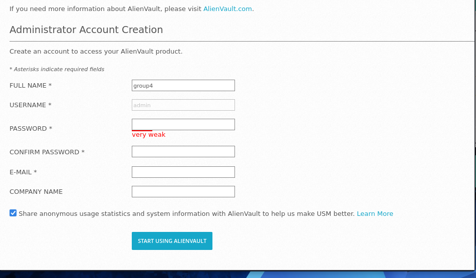
*Figure 17. The AlienVault web setup asks for administrator details. The password is still empty and is flagged as very weak at this stage.*

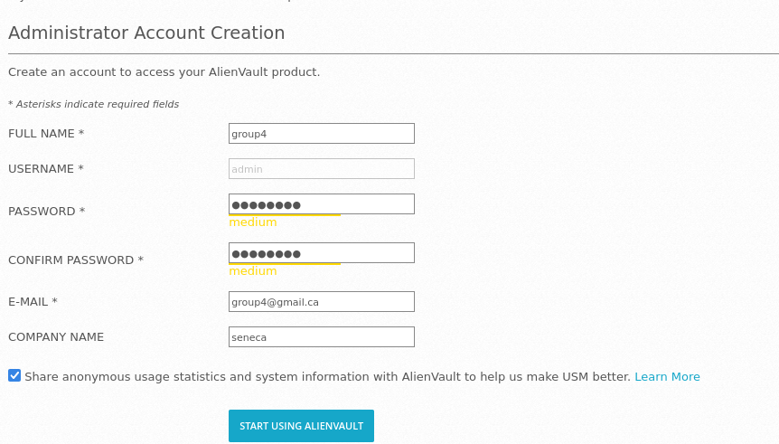
*Figure 18. The administrator form is completed with a medium-strength password, email address and company name. Clicking "Start Using AlienVault" finishes the initial setup.*

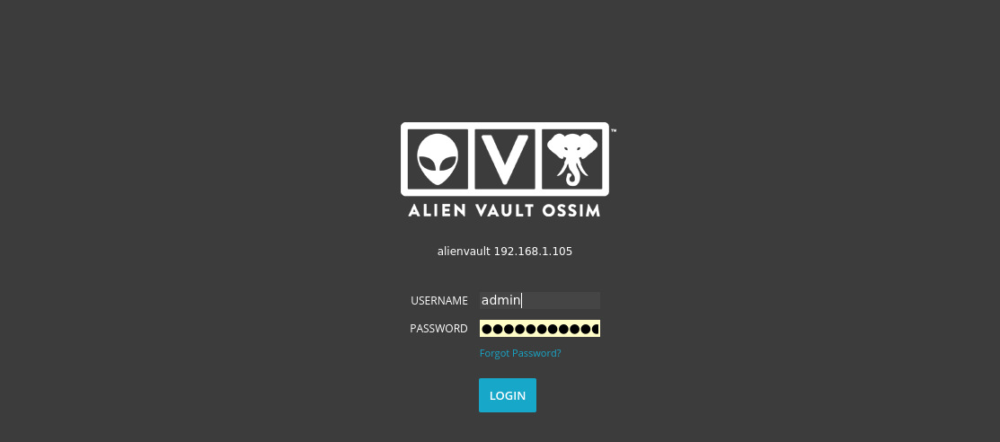
*Figure 19. The OSSIM login page at 192.168.1.105. Logging in opens the SIEM web console.*

The discovered hosts were then added as assets, with each host's OS type set to Linux or Windows.

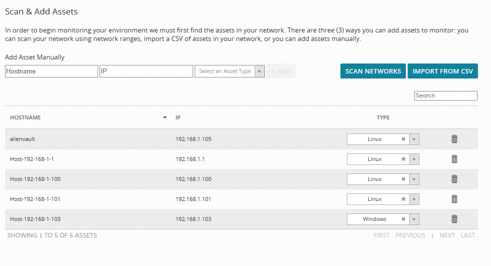
*Figure 20. The Scan & Add Assets page lists the five discovered hosts with their IP addresses and OS types. Setting each type lets the SIEM add them as monitored assets.*

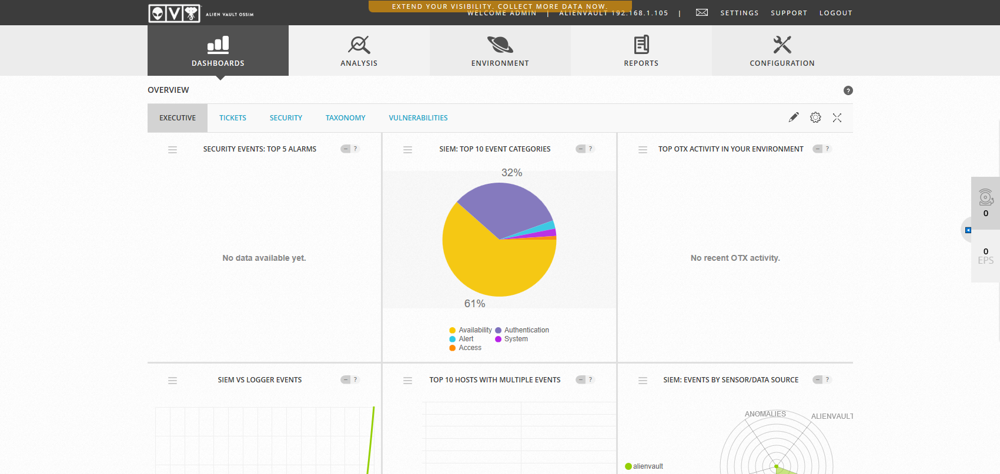
*Figure 21. The SIEM dashboard shows widgets for top event categories, top alarms and OTX activity. Most panels are empty because no agents are sending data yet.*

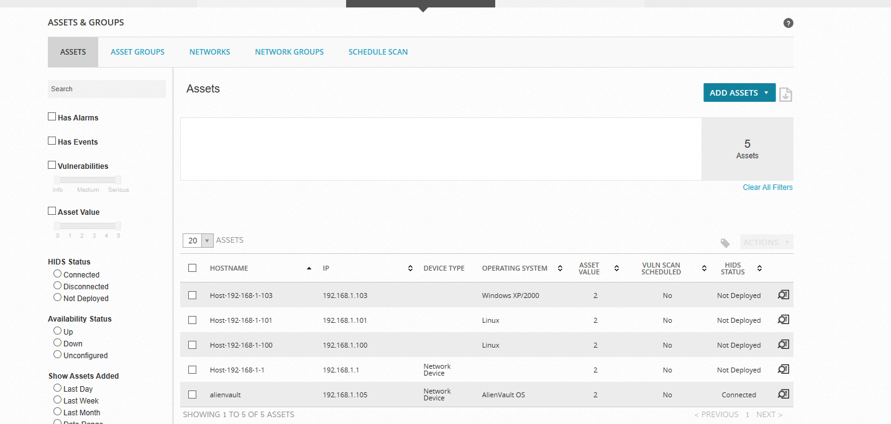
*Figure 22. The Assets page lists all five hosts. Only `alienvault` shows a HIDS status of Connected; the other four show Not Deployed. This is the baseline before the OSSEC agents are installed.*

## Phase 5: Deploying OSSEC HIDS Agents

**Version choice:** OSSEC Agent v3.6.0 was selected because it is the compatible version for AlienVault 5.7.4. The alternative is the preconfigured agent package downloaded from the AlienVault web UI.

**Windows endpoint:** The OSSEC HIDS Windows agent v3.6.0 installer completed successfully.

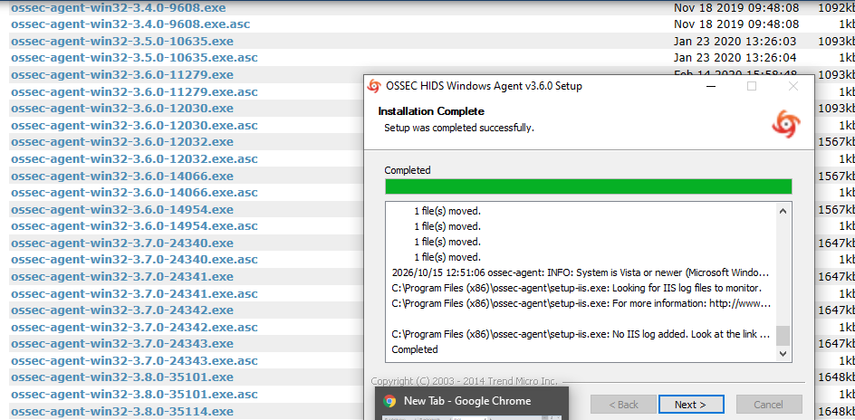
*Figure 23. The OSSEC HIDS Windows Agent v3.6.0 installer reports Installation Complete.*

**Registering the agent:** Under Environment > Detection > Agents, agent 001 was added for `Host-192-168-1-103`, and its authentication key was displayed. That key is imported into the OSSEC Agent Manager on the Windows machine, together with the OSSEC server IP.

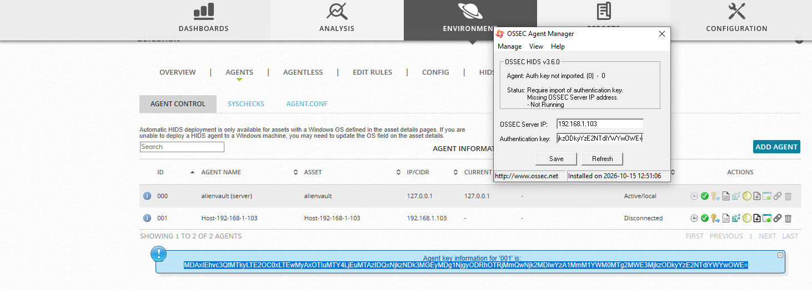
*Figure 24. Agent 001 is added for Host-192-168-1-103 and its authentication key is displayed. The key is imported into the OSSEC Agent Manager on Windows.*

**Restart HIDS:** The agent list displays the warning "You must restart HIDS for the changes to take effect." To apply the change:

1. Restart HIDS from the web console (Environment > Detection > HIDS > Control > Restart).
2. Wait about 60 seconds.
3. Click Refresh in the Windows Agent Manager and confirm the status changes to Active.

**Linux agents:** The Kali and Metasploitable2 agents were built from source using the same OSSEC version.

```bash
# On Kali: download and extract OSSEC 3.6.0
wget https://github.com/ossec/ossec-hids/archive/3.6.0.tar.gz
tar -xvf 3.6.0.tar.gz
cd ossec-hids-3.6.0/
sudo ./install.sh
```

```bash
# Copy the source to Metasploitable2 (legacy SSH algorithm needed)
scp -oHostKeyAlgorithms=+ssh-rsa -r ossec-hids-3.6.0 msfadmin@192.168.1.101:/tmp/
```

```bash
# On Metasploitable2: install build tools, then the agent
sudo apt-get update && sudo apt-get install -y gcc make build-essential
cd /tmp/ossec-hids-3.6.0/
sudo ./install.sh
```

## Phase 6: Threat Intelligence (OTX) and Troubleshooting

After the agents were set up, the SIEM could not download its OTX subscriptions. The deployment messages showed that AlienVault could not download the feed and that its configured DNS was external. This meant the SIEM could not yet reach `otx.alienvault.com`.

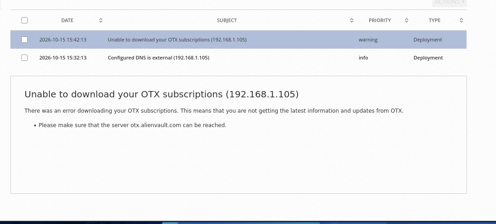
*Figure 25. The deployment messages show that AlienVault could not download its OTX subscriptions, and that the configured DNS is external.*

### Step 1: Check network interfaces

The `ifconfig` output showed three interfaces: `eth0` (192.168.89.5, management), `eth1` (192.168.1.105, log collection) and `lo` (127.0.0.1).

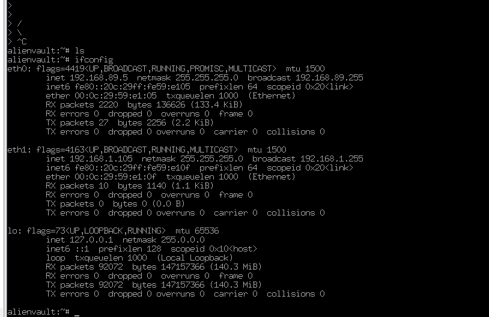
*Figure 26. The `ifconfig` output lists `eth0` (192.168.89.5), `eth1` (192.168.1.105) and the loopback interface.*

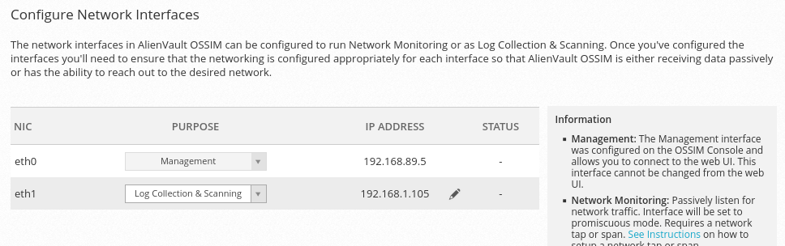
*Figure 27. The Configure Network Interfaces dashboard designates `eth0` for Management and `eth1` for Log Collection & Scanning.*

The interface configuration was then edited so that `eth1` has a static address and `eth0` gets its address by DHCP with promiscuous mode enabled:

```bash
sudo nano /etc/network/interfaces
```

```text
# The primary network interface
auto eth0
iface eth0 inet dhcp
    up ip link set $IFACE promisc on
    down ip link set $IFACE promisc off
```

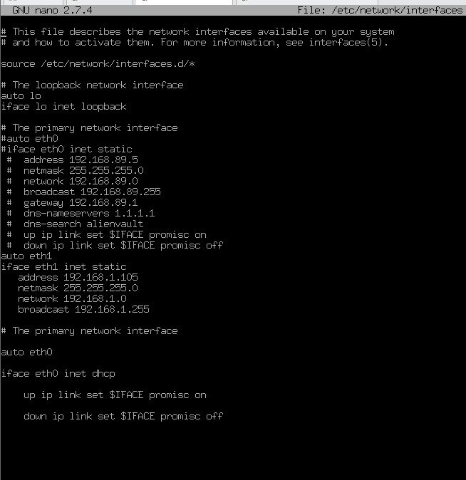
*Figure 28. The nano editor modifying `/etc/network/interfaces`. The loopback interface is configured, `eth1` has a static address (192.168.1.105), and `eth0` gets its address by DHCP with promiscuous mode enabled.*

### Step 2: Verify connectivity

The troubleshooting plan was to confirm DNS and outbound HTTP/HTTPS before retrying the feed. pfSense rules were to allow the SIEM address (192.168.1.105) to reach external DNS (UDP 53) and to reach any destination on ports 80 and 443, with those rules placed above any restrictive ones.

Connectivity checks run on the AlienVault server:

```bash
nslookup alienvault.com     # DNS resolution
curl -I https://alienvault.com  # expect HTTP/1.1 200 OK or HTTP/2 200
```

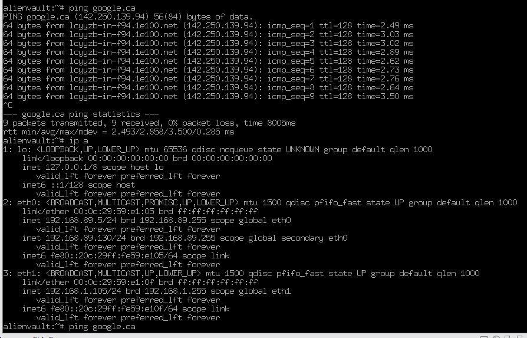
*Figure 29. `ping google.ca` succeeds with 0% packet loss, and `ip a` shows `eth0` and `eth1` in the UP state with their expected addresses.*

### Step 3: Re-enter the OTX key and reset the stored key

With connectivity confirmed, the OTX API key was re-entered in the AlienVault configuration. The key is taken from the OTX DirectConnect API page.

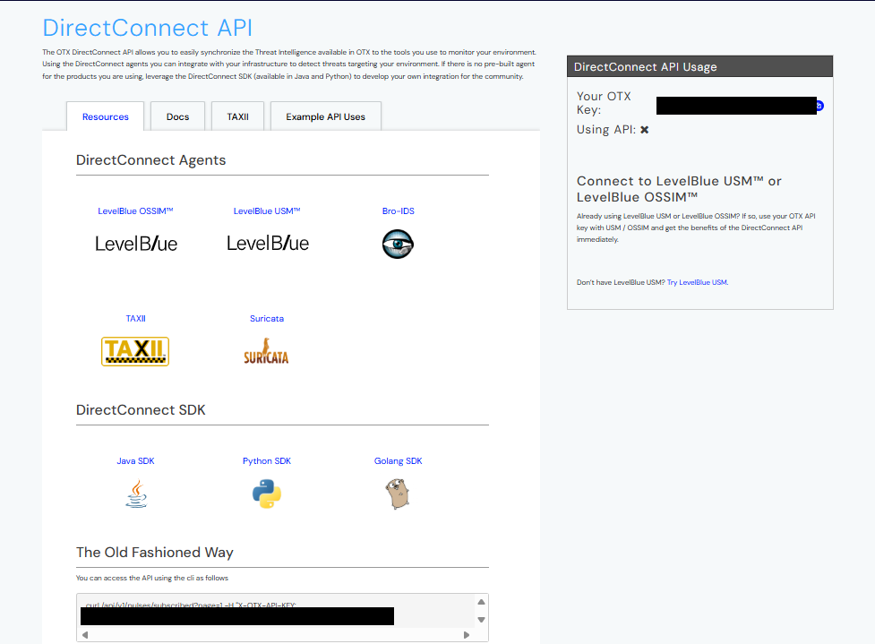
*Figure 30. The OTX DirectConnect API page shows the key that links AlienVault to Open Threat Exchange. The key is redacted here.*

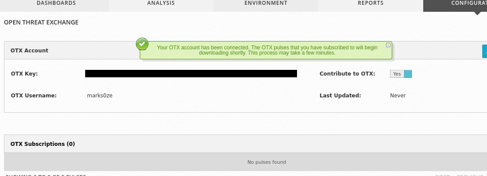
*Figure 31. The message "Your OTX account has been connected" confirms the key was accepted. Subscribed pulses begin downloading. The key is redacted here.*

Before the key was re-entered, the MariaDB `config` table was checked for a stale `otx_key` entry. The first `DELETE` failed because the key column is named `conf`, not `name`. The corrected query was then run, and the table was confirmed to hold no `otx_key` row.

```sql
DESCRIBE config;                                  -- columns are conf and value
DELETE FROM config WHERE conf='otx_key';          -- Query OK, 0 rows affected
SELECT * FROM config WHERE conf='otx_key';        -- Empty set
```

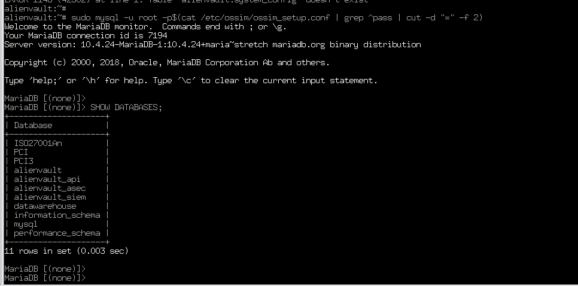
*Figure 32. Logging in to MariaDB with the credentials from `/etc/ossim/ossim_setup.conf`. The `SHOW DATABASES` output lists the AlienVault databases.*

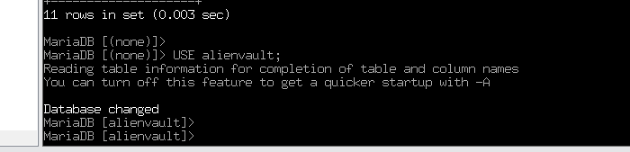
*Figure 33. `USE alienvault` selects the main SIEM database.*

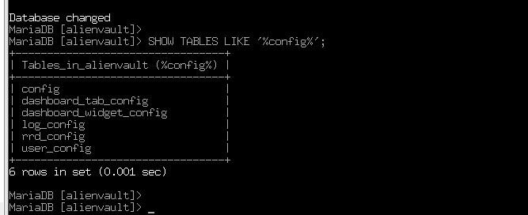
*Figure 34. `SHOW TABLES LIKE '%config%'` lists the configuration tables, including `config`.*

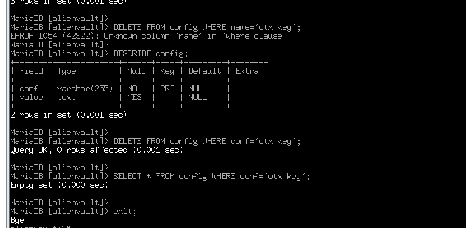
*Figure 35. The `config` table uses the columns `conf` and `value`. The corrected `DELETE` reports 0 rows affected, and the follow-up `SELECT` returns an empty set, so no stale key remained.*

### Step 4: Verify the API and the feed

The `alienvault-api` helper was used to check the OTX sync method, and the OTX endpoint was tested with curl. The response returned HTTP 200, so the server can reach OTX.

```bash
sudo alienvault-api otx_sync
curl -I https://otx.alienvault.com
```

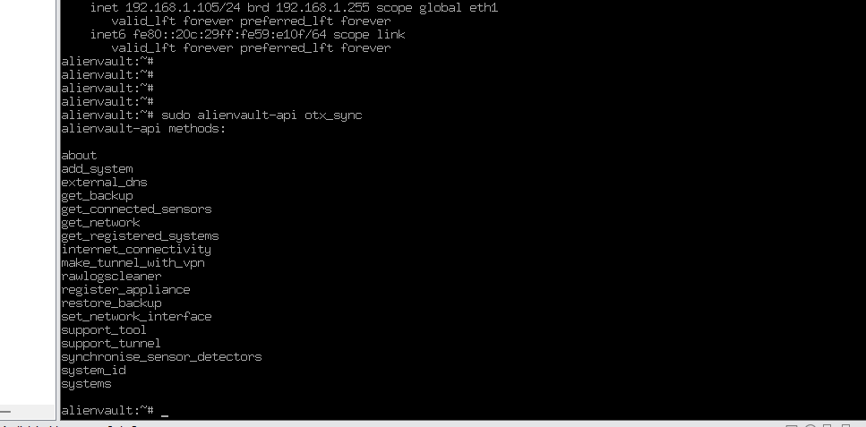
*Figure 36. The `alienvault-api` method list, including `otx_sync`.*

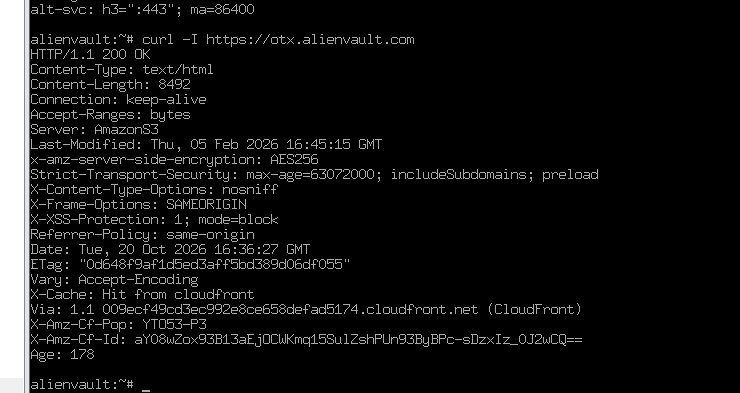
*Figure 37. `curl -I https://otx.alienvault.com` returns HTTP/1.1 200 OK from the OTX endpoint.*

The configuration was then applied with the reconfigure command. The `alienvault-update --feed` command from the original notes does not exist on this version, so the reconfigure step was used instead.

```bash
sudo alienvault-reconfig -c -v
```

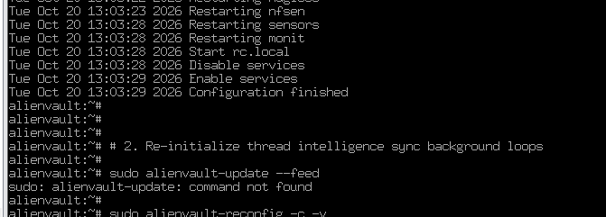
*Figure 38. `alienvault-reconfig -c -v` applies the platform changes and finishes with "Configuration finished".*

The OTX profile pages were also reviewed while checking the feed sources, including the subscribed pulses of the connected account and the official AlienVault publisher profile.

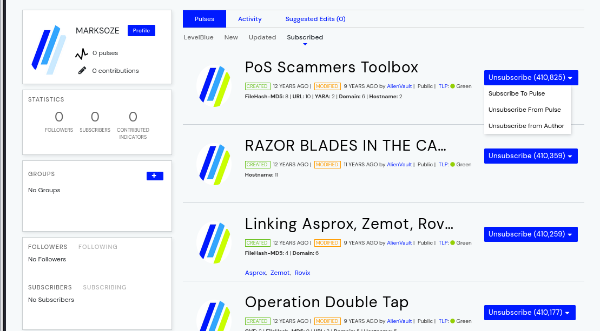
*Figure 39. The OTX profile's Subscribed tab lists the pulses the account follows.*

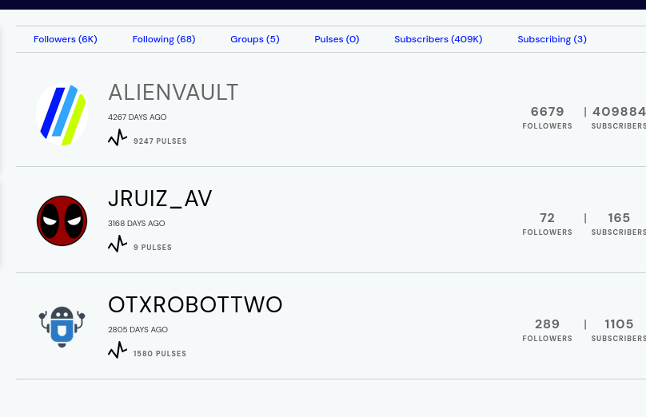
*Figure 40. OTX publisher profiles, including the official AlienVault account.*

## Results

After the network and configuration fixes, the SIEM downloaded the OTX subscription feed:

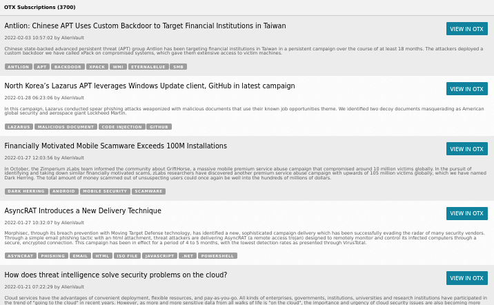
*Figure 41. The SIEM now shows 3,700 OTX subscriptions with threat-intelligence pulses such as Antlion, Lazarus and AsyncRAT.*

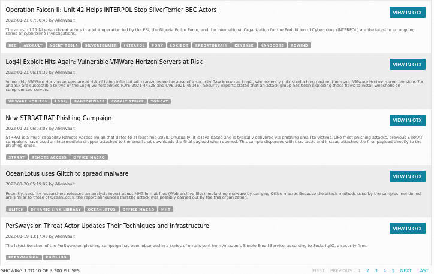
*Figure 42. Page 2 of the subscription list, showing pulses 1 to 10 of 3,700.*

**Outcome**

- Five lab machines are running together on an isolated LAN behind pfSense.
- AlienVault OSSIM is deployed, with administrator access and an asset inventory of all five hosts.
- Agent 001 is registered for the Windows 10 endpoint, and the OSSEC agent is installed.
- The SIEM has outbound connectivity and downloads 3,700 OTX threat-intelligence subscriptions.

## Lessons Learned

- **Segment first:** Putting every VM on one custom LAN segment behind pfSense makes network problems easier to isolate.
- **Verify in layers:** Check interfaces, then DNS, then outbound HTTP/HTTPS, and only then retry the application. This separated the network problem from the configuration problem.
- **Check the schema before running SQL:** The first `DELETE` failed because the column is `conf`, not `name`. Running `DESCRIBE` first would have avoided the error.
- **Match versions:** OSSEC 3.6.0 is the compatible agent version for AlienVault 5.7.4.
- **Restart services after changes:** Agent changes do not take effect until HIDS is restarted.
